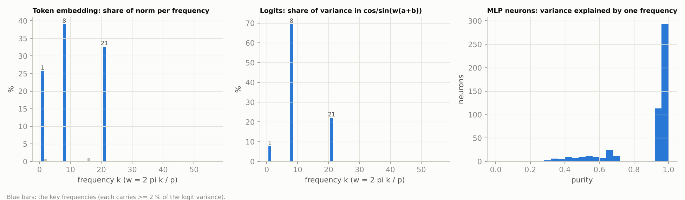
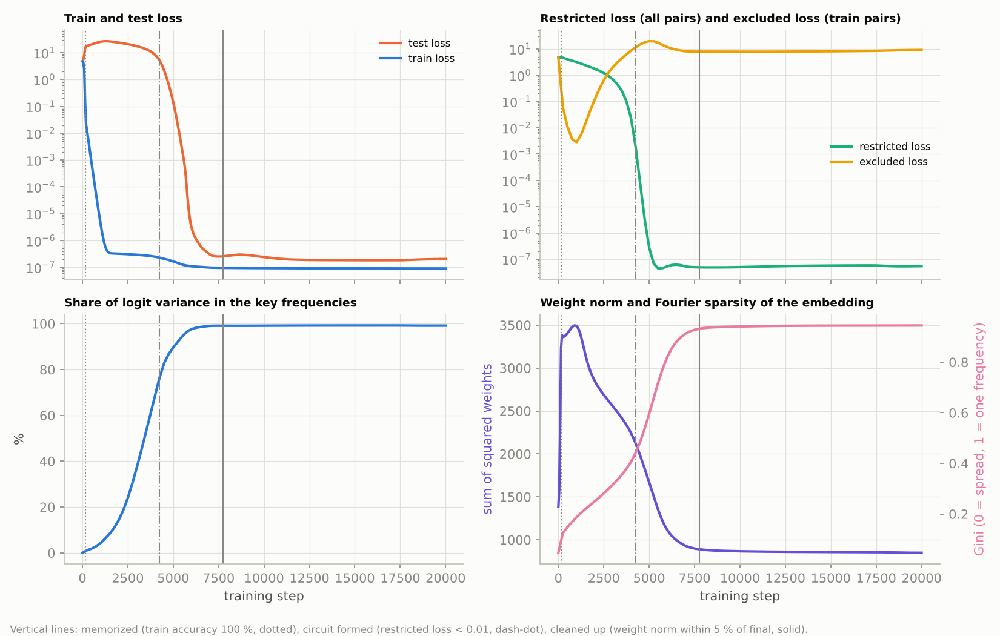
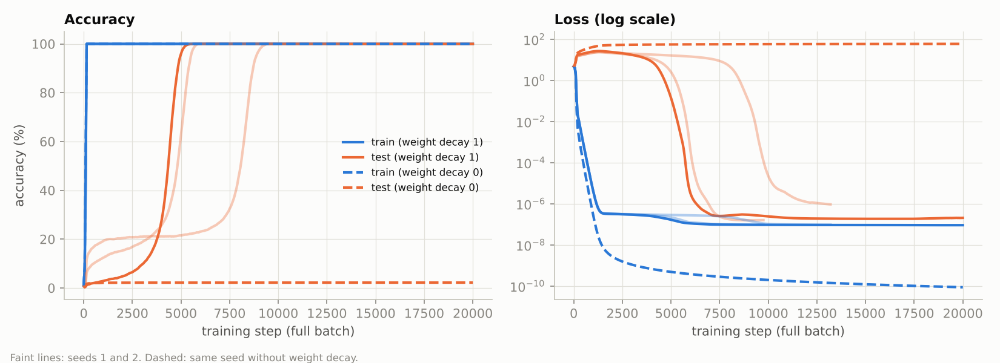
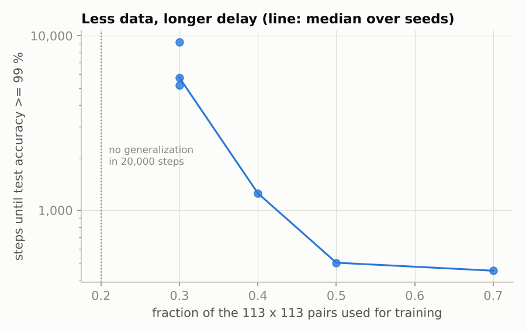

# Grokking: delayed generalization, the algorithm behind it, and when it forms

A 1-layer transformer learns (a + b) mod 113 from 30 % of all pairs:
- it fits the training pairs within 150 steps;
- it stays at chance on the held-out pairs for thousands of steps;
- then it generalizes abruptly.

This project replicates that "grokking" curve ([Power et al., 2022](https://arxiv.org/abs/2201.02177)) and the mechanistic account of [Nanda et al. (2023), *Progress measures for grokking via mechanistic interpretability*](https://arxiv.org/abs/2301.05217). It then uses that account to show the generalizing circuit forming *during* the plateau, long before test accuracy moves.

**Status: run end to end on a CPU. All numbers below are measured, from [`results/`](results).**

## Setup ([`grok_model.py`](grok_model.py), [`train.py`](train.py))
| | |
|---|---|
| Task | input `[a, b, =]`, label `(a + b) mod 113`; 3,830 of the 12,769 pairs (30 %) for training, the rest held out |
| Model | 1 layer, d_model 128, 4 heads, ReLU MLP with 512 neurons, no LayerNorm, learned positions (Nanda et al.'s model) |
| Training | full batch, AdamW lr 1e-3, betas (0.9, 0.98), **weight decay 1.0**, 20,000 steps; loss in float64, since train loss goes below 1e-7 |
| Runs | main run (seed 0) with progress measures saved every 250 steps; seeds 1 and 2; the same seed without weight decay; training fractions 0.2–0.7 |

## What the trained model computes
Nanda et al. showed the model implements a trigonometric algorithm:
1. **Embed** a and b as cos(wa), sin(wa), cos(wb), sin(wb) for a few "key" frequencies w = 2πk/113.
2. **Combine** them in the MLP with product identities into cos(w(a+b)) and sin(w(a+b)).
3. **Read out** logit(c) ≈ Σₖ αₖ cos(wₖ(a + b − c)), which peaks at c = (a + b) mod 113.

Every claim below is a measurement of that algorithm in the trained weights:



| Measurement (main run, final model) | Value | Meaning |
|---|---|---|
| Key frequencies | **k = 8, 21, 1** | found from the logits: each carries ≥ 2 % of their variance |
| Logit variance in cos/sin(wₖ(a+b)) for those 3 frequencies | **99.2 %** | of 56 possible frequencies, 3 explain the output |
| Token-embedding norm on the same 3 frequencies | 97.4 % (Gini 0.94) | the input representation is sparse in Fourier space |
| MLP neurons whose activation is > 80 % explained by one frequency | **80 %** (median 0.96) | neurons cluster by frequency |
| Neurons whose best frequency is a key frequency | **100 %** | no neuron works on anything else |
| **Restricted loss** (logits projected onto the key frequencies only, all pairs) | **5 × 10⁻⁸** | the 3-frequency algorithm alone solves the task |
| **Excluded loss** (key frequencies removed, *training* pairs) | **9.0** (uniform guessing: 4.73) | without them the model is worse than chance even on data it was trained on |

## When it forms: progress measures


The phases come from the measures themselves (definitions in [`analyze.py`](analyze.py)):
| Phase | Steps | What happens |
|---|---|---|
| Memorization | 0 – 150 | train accuracy reaches 100 %, test loss rises to ~25. At step 1,000 the excluded loss is at its minimum (0.003): the training-set fit uses essentially none of the key frequencies |
| Circuit formation | 1,000 – 4,250 | train loss stays below 10⁻⁶, but the **excluded loss climbs from 0.003 to > 10**: the fit to the training set moves onto the Fourier circuit. The restricted loss falls from 4.7 to < 0.01 while **test accuracy is still below 50 %** |
| Cleanup | 4,250 – 7,750 | weight decay removes the memorizing weights: the weight norm falls from ~2,100 to its final ~850 (it peaked at 3,490 during memorization). Test accuracy goes 50 % → 99 % between steps 4,350 and 5,200 |

The sudden jump in test accuracy is the *end* of a gradual process. The share of logit variance in the key frequencies rises smoothly from 4 % (step 1,000) to 37 % (3,000) to 90 % (5,000), and the embedding's Fourier sparsity rises with it.

## Controls: seeds, weight decay, amount of data


| Run | Train accuracy 100 % at | Test accuracy 50 % / 99 % at | Final test accuracy | Key frequencies | Logit variance in them | Neurons with purity > 0.8 |
|---|---|---|---|---|---|---|
| seed 0 (main) | 150 | 4,350 / 5,200 | 100 % | 8, 21, 1 | 99.2 % | 80 % |
| seed 1 | 200 | 4,850 / 5,750 | 100 % | 16, 30, 32, 56 | 98.9 % | 89 % |
| seed 2 | 150 | 8,100 / 9,200 | 100 % | 43, 46, 52, 53 | 98.3 % | 81 % |
| seed 0, **no weight decay** | 150 | never (20,000 steps) | **2.2 %** | none | < 0.4 % per frequency | — |

- **The mechanism replicates across seeds; the frequencies do not.** Every seed ends with 3–4 key frequencies carrying ≥ 98 % of the logit variance and > 80 % of neurons tied to a single frequency, but each seed picks *different* frequencies. Any set works for the algorithm, so which one wins is down to the initialization.
- **When it happens varies.** Seeds 0, 1 and 2 generalize at steps 5,200, 5,750 and 9,200. In each seed the order is the same: the circuit forms, then cleanup, then the test accuracy jump.
- **Without weight decay there is no grokking within 20,000 steps.** The model drives train loss to 10⁻¹⁰ and its weight norm *up* (1,380 → 5,100), and test accuracy stays at chance. No frequency carries more than 0.4 % of the logit variance: pure memorization. Weight decay is what makes the compact Fourier solution cheaper than a lookup table.



| Fraction of pairs for training | Train accuracy 100 % at | Test accuracy 99 % at |
|---|---|---|
| 0.2 | 150 | never (20,000 steps; final 1.4 %) |
| 0.3 | 150–200 | 5,200 – 9,200 (3 seeds) |
| 0.4 | 200 | 1,250 |
| 0.5 | 200 | 500 |
| 0.7 | 150 | 450 |

- **Grokking is a small-data phenomenon with a cliff.**
  - With half the pairs or more, the model generalizes almost as soon as it fits; there is no delay to speak of.
  - Below that, the delay grows fast: at 0.3 it is 10–18× longer than at 0.5.
  - At 0.2 it did not generalize within the budget at all.
- Each data-fraction run stops 500 steps after generalizing, so only its timing is compared, not its final mechanism measures.


## Tests (`pytest tests/test_grokking.py`, 8 tests, ~5 s)
- **Data:** labels and a disjoint split.
- **Fast forward pass equals the full causal transformer.** The model computes only the last position, which is exact for one layer; a test checks it against the full causal transformer.
- **Fourier tools on inputs with known answers:**
  - a single-frequency embedding gives share 1 and Gini ≈ 1;
  - ideal algorithm logits Σ cos(wₖ(a+b−c)) give restricted loss = full loss and excluded loss = log p;
  - hand-built neurons give purity 1 or 0.5, and NaN when dead.
- **End to end:** a smoke run of `train.py` + `analyze.py`.

```bash
python train.py      # the whole study; finished runs are skipped
python analyze.py    # results/summary.md and figures
```
