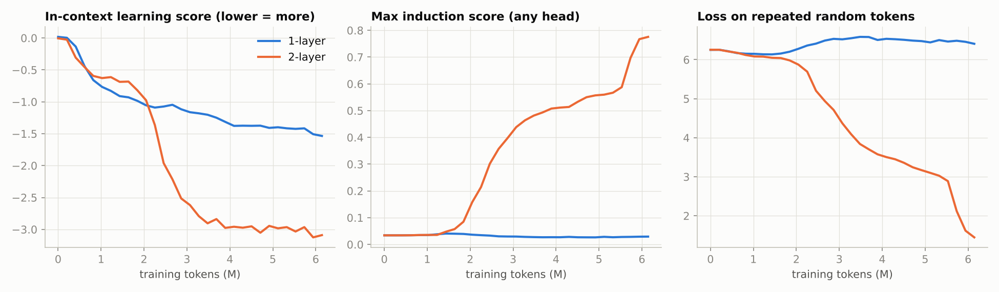
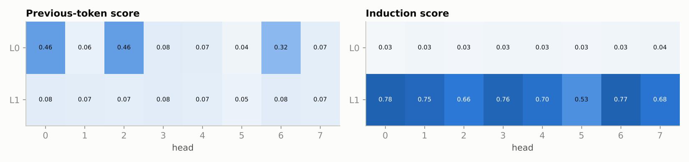
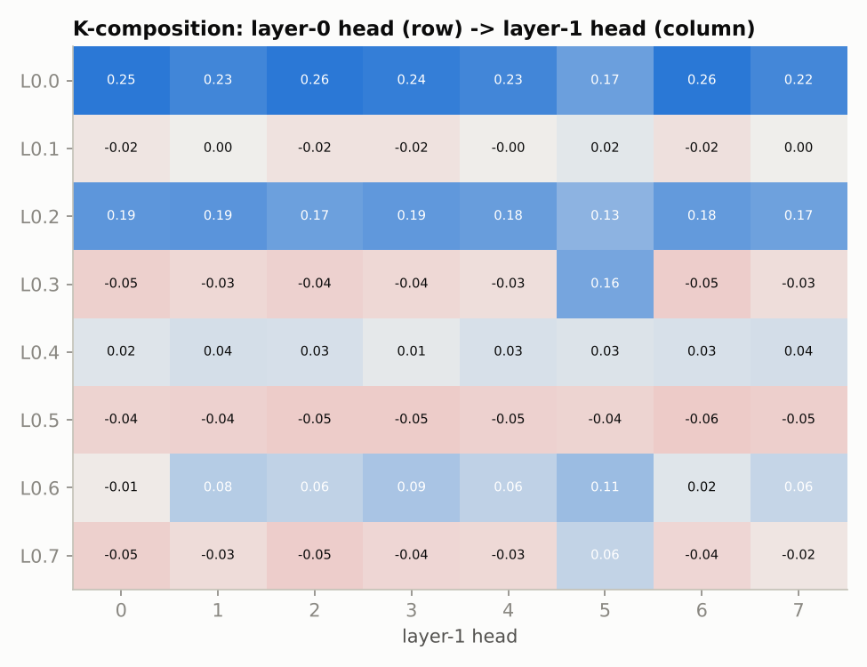

# Induction heads: watching in-context learning appear in a transformer

A replication of Anthropic's [*In-context Learning and Induction Heads*](https://transformer-circuits.pub/2022/in-context-learning-and-induction-heads/index.html) (Olsson et al., 2022) and the circuit analysis of [*A Mathematical Framework for Transformer Circuits*](https://transformer-circuits.pub/2021/framework/index.html) (Elhage et al., 2021). The project trains 1-layer and 2-layer attention-only transformers and measures five things:
1. the **phase change** as it happens;
2. **head scores** that locate the heads responsible;
3. **causal ablations** to show those heads do the work;
4. **composition scores** that read the circuit off the weights alone, without running the model;
5. a **1-layer control** that has no earlier layer to compose with.

**Status:**
- The full experiment on FineWeb-Edu text needs a GPU and has not been run yet.
- A **small CPU demo on synthetic text has been run**, and its real results are below and in [`results/synthetic_cpu_demo/`](results/synthetic_cpu_demo).

## The circuit
An induction head completes repeated patterns: after "… A B … A", it predicts **B**. It takes two heads in different layers:
1. a **previous-token head** in layer 0 writes "the token before me was A" into each position;
2. an **induction head** in layer 1 builds its keys from that information (**K-composition**), so the query at the second A attends to the position after the first A and copies **B** into the output.

## Measurements ([`attn_only.py`](attn_only.py))
| Measurement | Definition |
|---|---|
| In-context learning score | loss late in the context minus loss early on (more negative = uses context more) |
| Induction score (per head) | on [random tokens, the same tokens again]: attention from position *i* to *i − L + 1* |
| Previous-token score (per head) | attention from *i* to *i − 1* |
| Repeated-sequence loss | loss on the second, copyable half of those sequences |
| Ablation | zero a head's output and re-measure |
| Composition score | ‖M₁M₀‖ / (‖M₁‖‖M₀‖) between layer-1 W_QK and layer-0 W_OV, minus the chance level for random matrices of the same rank |

## CPU demo on synthetic text (measured)
**Setup:**
- Text is LZ77-style synthetic: random tokens where about half the text copies an earlier span.
- Models: d_model 64, 8 heads, context 64, 3,000 steps (6M tokens), ~2 min on a laptop CPU.
- Command: `python train.py --synthetic --steps 3000 --batch 32 --seq_len 64 --d_model 64 --n_head 8 --vocab 512 --rep_len 20 --eval_every 100 --lr 3e-3 --out_dir results/synthetic_cpu_demo`



| Final model | Max induction score | Repeated-sequence loss | In-context learning score |
|---|---|---|---|
| 1-layer | 0.03 | 6.41 (chance: ln 512 = 6.24) | −1.54 |
| **2-layer** | **0.78** | **1.45** | **−3.09** |

- **The phase change:** between about 1.5M and 3M tokens, the 2-layer model's induction score rises from 0.05 to 0.44 and its in-context learning score drops by about 1.9 nats (−0.69 → −2.62).
- **The 1-layer control:** the model never forms an induction head, and its repeated-sequence loss stays at chance. It still improves somewhat on context, using single-layer "skip-trigram" copying.



**Which heads do the work:**
- **Previous-token heads:** layer-0 heads 0, 2 and 6 score 0.46, 0.46 and 0.32. Every other layer-0 head scores ≤ 0.08.
- **Induction heads:** all 8 layer-1 heads became induction heads (0.53–0.78), so this small model has a lot of redundancy.



**The weights alone show the circuit.** Every layer-1 induction head K-composes most with L0.0 and L0.2, the two strongest previous-token heads: mean scores of 0.23 and 0.17 above chance. The non-previous-token heads sit at ≈ 0.

| Ablated (zeroed) | Repeated-sequence loss | ICL score |
|---|---|---|
| nothing | 1.45 | −3.09 |
| top induction head | 1.78 | −2.99 |
| top 2 induction heads | 2.24 | −2.77 |
| 2 random other layer-1 heads (also induction heads here) | 2.02 | −2.81 |
| top previous-token head (L0.0) | 3.47 | −1.98 |
| a random other layer-0 head | 1.52 | −3.07 |
| **all 8 induction heads** | **6.96** | −1.26 |
| **the 3 previous-token heads** | **6.69** | −0.61 |

**What the ablations show:**
- **Group ablations remove copying entirely.** With all induction heads gone, or the three previous-token heads that feed them, repeated-sequence loss rises above chance.
- **Single induction heads matter little because of redundancy.** That is why "random other" layer-1 heads hurt about as much as the top ones: here, they are induction heads too.
- **A random layer-0 head changes nothing.** The previous-token heads are specifically what the induction heads depend on.

## The full experiment (GPU, pending)
```bash
cd ../../systems/gpt-pretraining-scaling-laws && python prepare_data.py --train_tokens 3e8 && cd -
python train.py      # 1L + 2L, d_model 256, 8 heads, context 256, 6,000 steps x 8k tokens each, ~20 min on an A100
```
Outputs go to `results/`, in the same format as the demo. On natural text, expect a less dramatic but still visible bump. Olsson et al. show the phase change in small attention-only models occurs early in training and coincides with the loss-curve "bump".

## Tests (`pytest tests/test_induction_heads.py`, 7 tests, ~26 s on CPU)
- **Patterns:** attention patterns are causal probability distributions.
- **Scores:** the score functions return 1 on ideal hand-built induction and previous-token patterns.
- **Ablation:** ablating every head in a layer equals removing the layer.
- **Circuit matrices:** W_QK reproduces the model's attention scores, and composition scores of a random model are near chance.
- **End to end:** a 25-second training run, verified on 3 seeds, in which the 2-layer model forms induction heads (> 0.4) and the 1-layer model does not (< 0.15), and ablating them restores the copying loss.

## References
Elhage et al., *A Mathematical Framework for Transformer Circuits* (2021) · Olsson et al., *In-context Learning and Induction Heads* (2022) · Nanda & Bloom, *TransformerLens*.
