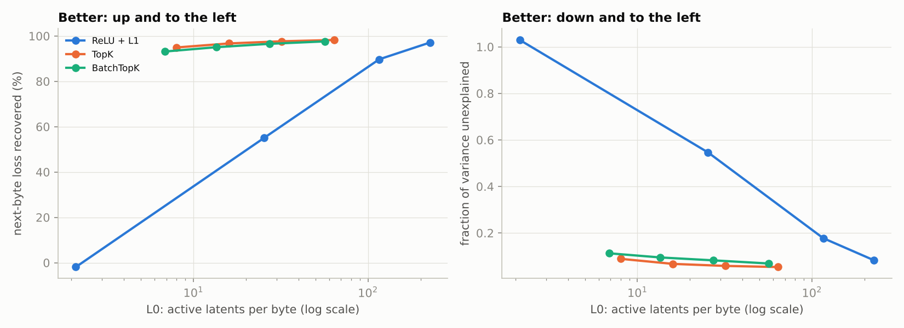
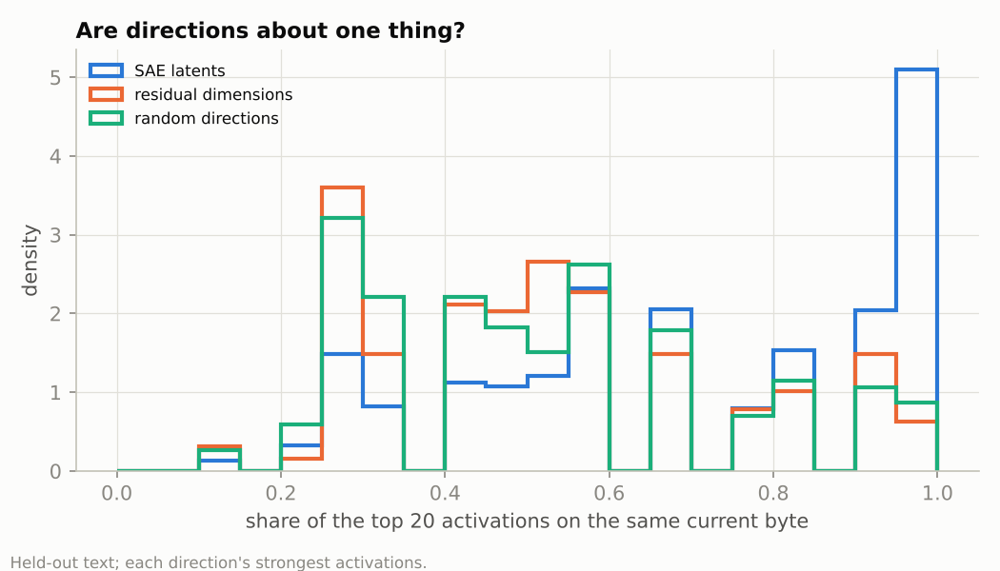

# Sparse autoencoders: dictionary learning on a language model's residual stream

Sparse autoencoders (SAEs) are the main tool for finding interpretable features inside language models ([Bricken et al., 2023](https://transformer-circuits.pub/2023/monosemantic-features); [Templeton et al., 2024](https://transformer-circuits.pub/2024/scaling-monosemanticity/)). An SAE rewrites each activation as a sparse combination of many more learned directions, hoping each direction is one human-understandable feature. This project trains SAEs from scratch ([`sae_lib.py`](sae_lib.py)) on a small byte-level language model and asks two questions:
1. Which sparsity mechanism reconstructs the model best per active latent?
2. Are the latents actually more interpretable than the model's own dimensions, or than random directions?

**Status: run end to end on a CPU (~30 min). All numbers below are measured, from [`results/`](results).**

## Setup ([`train.py`](train.py))
| | |
|---|---|
| Model | 4-layer byte-level GPT (d_model 128) trained on Python standard-library source, 8.2M bytes; 1.495 bits/byte on held-out files |
| Activations | residual stream after layer 2 of 4: 524k training bytes, 32k held-out bytes, scaled so the mean squared norm equals the width |
| SAEs | 2,048 latents (16× the width), unit-norm decoder rows, Adam, 600 steps × 4,096 activations (≈ 4.7 passes) |
| Sparsity mechanisms | ReLU + L1 at 4 coefficients; **TopK** (keep the k largest per byte; [Gao et al., 2024](https://arxiv.org/abs/2406.04093)) and **BatchTopK** (keep k × batch largest across the batch; [Bussmann et al., 2024](https://arxiv.org/abs/2412.06410)) at k = 8, 16, 32, 64 |
| Metrics | **L0**: active latents per byte. **FVU**: fraction of variance unexplained. **Loss recovered**: splice the reconstruction into the model and measure next-byte loss, as a fraction of the gap between mean-ablating the layer (0 %) and the clean model (100 %). **Dead latents**: never active on held-out text |

## Results
### 1. TopK-style SAEs dominate ReLU + L1


| SAE | L0 | FVU | Loss recovered | Dead latents |
|---|---|---|---|---|
| ReLU + L1, L1 = 3 | 25.4 | 0.546 | 55.0 % | 0 % |
| ReLU + L1, L1 = 1 | 116.0 | 0.178 | 89.7 % | 0 % |
| ReLU + L1, L1 = 0.3 | 226.5 | 0.083 | 97.1 % | 0 % |
| **TopK, k = 8** | **8.0** | **0.089** | **94.9 %** | 8.3 % |
| TopK, k = 16 | 16.0 | 0.067 | 96.7 % | 0.2 % |
| TopK, k = 32 | 32.0 | 0.058 | 97.7 % | 0 % |
| TopK, k = 64 | 64.0 | 0.054 | 98.2 % | 0 % |
| BatchTopK, k = 8 | 6.9 | 0.113 | 93.2 % | 14.5 % |
| BatchTopK, k = 32 | 27.3 | 0.082 | 96.5 % | 0.2 % |

All 12 SAEs are in [`results/summary.md`](results/summary.md).

- **TopK wins by a wide margin.** It matches ReLU + L1's reconstruction with **~28× fewer active latents** (FVU ≈ 0.08 at L0 8 vs L0 227).
  - **Why:** L1 shrinks every activation it keeps, so it must keep many to reconstruct well. TopK selects without shrinking.
  - **Caveat:** ReLU + L1 is known to need longer training and an L1 warm-up. It got the same 600 steps as the others, so its gap is partly a training-budget effect.
- **BatchTopK is not better here.** It sits slightly below TopK at the same L0, and has more dead latents at small k (14.5 % vs 8.3 % at k = 8). Its advantage, adaptive per-byte sparsity, does not show at this scale.
- **Dead latents are a small-k problem.** They appear only at k ≤ 16 (8–15 %) and vanish by k = 32. No auxiliary loss was used to revive them.

### 2. The latents are much more interpretable than the model's dimensions or random directions
For every direction, take its 20 strongest activations on held-out text and measure "purity": the share of them on the same current byte. Measured for the TopK (k = 32) SAE's 1,964 live latents, the model's 128 residual dimensions (both signs) and 2,048 random directions:

| Directions | Median share on one current byte | Directions with ≥ 90 % on one byte | Median share on one byte class |
|---|---|---|---|
| **SAE latents** | **70 %** | **36 %** | **95 %** |
| residual-stream dimensions | 50 % | 11 % | 75 % |
| random directions | 45 % | 10 % | 75 % |



- **Three times more single-byte directions.** 36 % of SAE latents fire mostly (≥ 90 %) on a single byte, against 10–11 % of residual dimensions or random directions.
- **The model's own dimensions are barely better than random.** That is the superposition picture: features are not aligned with the basis.

**What the latents represent.** From [`results/features.md`](results/features.md), a *random* (not cherry-picked) sample of 30 live latents with their top contexts, for example:
- **Python syntax in context:**
  - the `e` of `raise` (100 % purity);
  - the `e` of `return`;
  - a `,` after `self` in method signatures (`def log(self, …`);
  - the `:` that ends a line before an indented block;
  - `*` in `**kwargs`;
  - `class` after a blank line.
- **Library-specific patterns:**
  - the `x` in hexadecimal literals (`0x00b1`, 100 %);
  - the `u` in `'≤'` escapes;
  - parts of Unicode character names in codec tables (`BOX DRAWINGS DOUBLE VERTICAL`).
- **Some latents are polysemantic or diffuse:** one fires on 40 % of all bytes.

## Limits
- **A deliberately weak purity test.** It only captures features tied to the *current* byte. Features about longer context (inside a string, indentation depth) can be real but score low.
- **Small scale.** The model is tiny, and each SAE is trained once (one seed). Differences of a few tenths of a percent in loss recovered are within run-to-run noise.

## Tests (`pytest tests/test_sparse_autoencoders.py`)
- **Sparsity mechanisms:**
  - TopK keeps at most k latents per byte;
  - BatchTopK keeps k × batch in training and switches to its learned threshold at inference.
- **Decoder rows** stay unit-norm, and a larger L1 penalty gives sparser codes.
- **Known-answer test:** data built from 32 planted sparse atoms is reconstructed with FVU < 0.05, and ≥ 90 % of the atoms are recovered with cosine > 0.9.
- **Purity statistic:** checked on constructed activations.
- **End to end:** a smoke run.

```bash
python train.py                    # trains the LM once (cached in checkpoints/, git-ignored), then every SAE
python train.py --features_only    # redo only the feature analysis
python analyze.py
```
