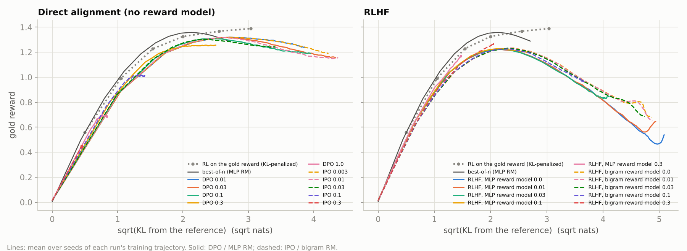
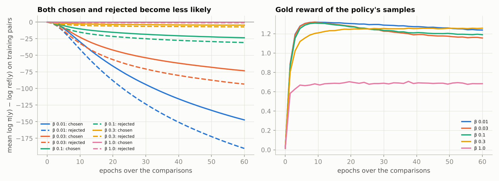

# DPO vs RLHF: does skipping the reward model skip reward overoptimization?

[DPO](https://arxiv.org/abs/2305.18290) and [IPO](https://arxiv.org/abs/2310.12036) train a policy directly on preference pairs, with no separate reward model and no RL loop. They are now the default for much post-training. Do they escape the overoptimization that hits RLHF? [Rafailov et al. (2024)](https://arxiv.org/abs/2406.02900) report that they do not. This study measures it in the exact-KL setup of the [reward-model overoptimization study](../reward-model-overoptimization), so every method is compared on gold reward against KL(policy ‖ reference) on the same comparisons.

**Status: run end to end on a CPU (~10 min). All numbers below are measured, from [`results/`](results).**

## Setup ([`direct_alignment.py`](direct_alignment.py), [`train.py`](train.py))
- **Shared with the overoptimization study:** the policy (16 tokens, vocabulary 8, Markov, exact KL), the reference policy, and the gold reward with diminishing returns (`d − d²/5`).
- **Data:** 10,000 gold-labelled comparisons with Bradley-Terry noise.
- **Methods, all trained on the same comparisons for each seed:**

| Method | Strengths swept | Training |
|---|---|---|
| DPO | β ∈ {0.01, 0.03, 0.1, 0.3, 1} | 1,200 Adam steps × 512 pairs (~60 epochs) |
| IPO | τ ∈ {0.003, 0.01, 0.03, 0.1, 0.3} | same |
| RLHF, MLP reward model | KL coefficient ∈ {0, 0.01, 0.03, 0.1, 0.3} | Bradley-Terry MLP reward model, then 800 RLOO steps |
| RLHF, **bigram** reward model | same | a reward model in *exactly* DPO's implicit-reward function class for this policy (a sum of per-position bigram scores) |
| best-of-n | n up to 4,096 | MLP reward model, exact estimator |

- **Statistics:** 3 seeds (new comparisons and initialization each), mean ± std.
- **Why the bigram control:** RLHF with the bigram reward model separates "DPO vs RL" from "which reward function class".

## Results


| Method (best strength for its final gold) | Peak gold | KL at peak | Final gold | Final KL |
|---|---|---|---|---|
| DPO, β = 0.3 | 1.26 ± 0.01 | 5.4 | **1.26 ± 0.01** | 6.3 |
| DPO, β = 0.01 (weakest) | **1.32 ± 0.01** | 7.8 | 1.24 ± 0.04 | 14.9 |
| IPO, τ = 0.03 | 1.30 ± 0.01 | 5.8 | 1.24 ± 0.07 | 11.7 |
| RLHF (MLP RM), KL coef 0.1 | 1.23 ± 0.01 | 4.8 | 1.20 ± 0.02 | 7.2 |
| RLHF (MLP RM), no KL penalty | 1.22 ± 0.01 | 4.7 | 0.54 ± 0.07 | 25.9 |
| RLHF (bigram RM), KL coef 0.3 | 1.27 ± 0.01 | 4.2 | 1.26 ± 0.01 | 4.2 |
| RLHF (bigram RM), no KL penalty | 1.23 ± 0.02 | 5.8 | 0.68 ± 0.32 | 23.8 |
| best-of-n (MLP RM) | 1.36 ± 0.00 | 4.5 (n = 256) | 1.29 at n = 4,096 | 7.3 |

All 20 settings are in [`results/summary.md`](results/summary.md). For reference, RL on the gold reward itself reaches 1.37 at KL 6.5.

**Best gold reached within a KL budget** (any strength, seed or point in training):

| Method | KL ≤ 2 | KL ≤ 4 | KL ≤ 8 |
|---|---|---|---|
| DPO | 1.12 | 1.26 | **1.33** |
| IPO | 1.05 | 1.28 | **1.33** |
| RLHF, MLP RM | 1.14 | 1.23 | 1.24 |
| RLHF, bigram RM | 1.07 | 1.27 | 1.28 |

1. **Direct alignment overoptimizes too, but much more gently.**
   - DPO and IPO peak at 1.32–1.33, close to RL on the gold reward at the same KL, and higher than either RLHF variant (1.22–1.28).
   - Trained on far past the peak (KL 15–19), they still hold 1.15–1.24.
   - RLHF without a strong KL penalty falls to 0.54–0.68.
   - So **with weak regularization, DPO is far more forgiving.** With well-chosen strengths, every method ends in the same place (1.20–1.26).
2. **It is not the reward's function class: the control rules that out.** RLHF with the bigram reward model, which can represent exactly the rewards DPO's implicit reward can, overshoots just as badly as with the MLP reward model (0.68 vs 0.54). The difference comes from *how* the policy is optimized:
   - DPO only ever pushes on the sequences in the dataset, so it moves slowly and reaches far-off regions only indirectly.
   - RL samples its own outputs and climbs wherever the reward model points.
3. **DPO makes both preferred and rejected sequences less likely.** By the end of training, the log-probability (relative to the reference) of the *preferred* sequences drops by 4.5 nats at β = 0.3 and by 147 nats at β = 0.01. The rejected ones drop faster, so the margin grows, and the probability mass goes to sequences in neither set. This is the "likelihood displacement" reported for LLM DPO.

   

   Meanwhile, the implicit reward orders held-out pairs like the gold reward only 80–82 % of the time, no better than a separately trained bigram reward model (82 %).
4. **More preference data makes DPO overshoot harder, as with reward models.** At β = 0.03 and a fixed 1,200 steps:

| Comparisons | Peak gold | KL at peak | Final gold |
|---|---|---|---|
| 1,000 | 1.26 ± 0.02 | 17.5 | 1.09 ± 0.07 |
| 10,000 | 1.32 ± 0.01 | 7.2 | 1.16 ± 0.07 |
| 100,000 | 1.32 ± 0.00 | 6.2 | **0.89 ± 0.06** |

   - More data reaches the peak sooner but falls further after it, the same pattern as the reward-model study.
   - Cleaner in-distribution signal lets the optimizer follow the "more `d` is better" trend past the point where it turns.

## Limits
- **One designed failure mode.** The gold reward isolates a single way to fail: extrapolating an in-distribution trend. The policy is a small Markov model, not an LLM.
- **Offline DPO only.** DPO here is purely offline. Online or iterative DPO samples its own outputs like RL does, and may behave more like RLHF.

## Tests (`pytest tests/test_dpo_vs_rlhf.py`)
- **Losses at the reference:** DPO = log 2 and IPO = (1/2τ)², and one gradient step raises the chosen sequence over the rejected one.
- **Training:** DPO raises gold reward.
- **Function class:** the bigram reward model represents β·log(π/ref) of a Markov policy *exactly*, checked over all sequences, which is the claim the control rests on.
- **Bigram reward model:** it learns a bigram gold reward.
- **Frontier:** the envelope helper.
- **End to end:** a smoke run.

```bash
python train.py      # ~10 min on one CPU core
python analyze.py
```
