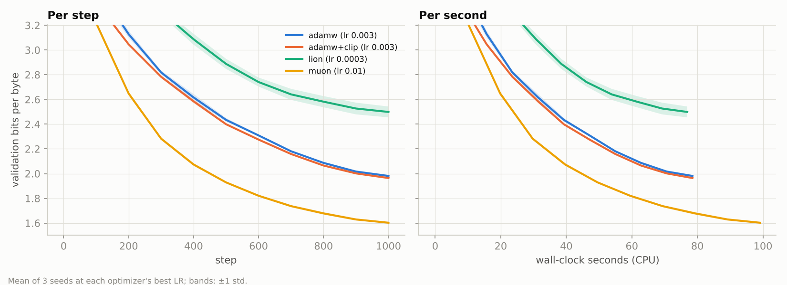
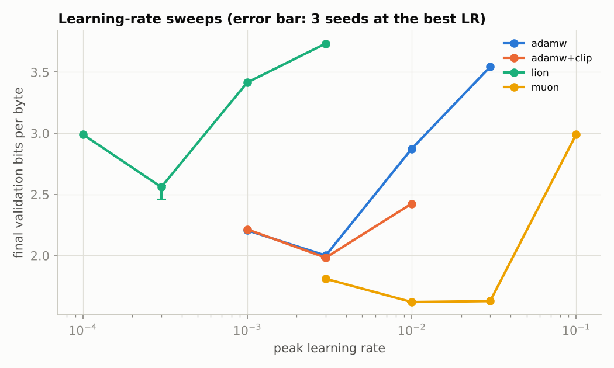

# AdamW vs. Muon vs. Lion: a controlled optimizer comparison

[Muon](https://kellerjordan.github.io/posts/muon/) (used in the NanoGPT speedruns and in [Moonshot's Kimi K2](https://arxiv.org/abs/2502.16982)) and [Lion](https://arxiv.org/abs/2302.06675) (found by Google's program search) both claim to beat AdamW for training transformers. Optimizer claims are easy to get wrong:
- the new optimizer gets a tuned learning rate and the baseline doesn't;
- one seed's noise is read as an effect;
- a per-step win hides a per-second loss.

This project implements Muon and Lion from their papers and compares them with AdamW under one fixed protocol.

**Status: run end to end on a CPU. All numbers below are measured, from [`results/`](results).**

## Protocol (fixed before running)
| | |
|---|---|
| Model | 4-layer byte-level GPT, d_model 128, 4 heads, context 64 (0.86M parameters; [`dl_common/bytelm.py`](../../src/dl_common/bytelm.py)) |
| Data | the Python standard library's own source, 639 files for training and 31 held out, split by file (no download; [`dl_common/byte_corpus.py`](../../src/dl_common/byte_corpus.py)) |
| Budget | 1,000 steps × 32 sequences × 64 bytes = 2M bytes; 50 warmup steps, cosine decay to 10 %; identical data order for every optimizer at a given seed |
| Tuning | a 4-point learning-rate sweep per optimizer on a 3× grid (seed 0); the best is inside every grid, never at an edge |
| Statistics | the best LR re-run with seeds 1 and 2; mean ± std over 3 seeds; Welch t-test vs AdamW |
| Metric | validation bits per byte on 1,024 held-out windows (65k bytes) |
| Fairness checks | AdamW with gradient clipping at 1.0 (standard for GPT training; Muon does not need it); the best AdamW and Muon re-run for 3× the steps; step time measured in a separate, interleaved benchmark |

**Implementation choices ([`optimizers_from_scratch.py`](optimizers_from_scratch.py)):**
- **Muon:**
  - Nesterov momentum 0.95;
  - the update is orthogonalized with 5 quintic Newton-Schulz iterations, scaled by √max(1, rows/cols);
  - it applies only to the hidden weight matrices. Embeddings, output head and LayerNorm use AdamW at 3e-3.
- **Lion:** β = (0.9, 0.99), with 10× AdamW's weight decay because its learning rate is ~10× smaller.
- **AdamW:** β = (0.9, 0.95), weight decay 0.1 on matrices only.

## Results


| Optimizer | Best LR | Val bits/byte (3 seeds) | Δ vs AdamW | p (Welch) | Steps to AdamW's final loss | Step time (interleaved benchmark) | Speedup to AdamW's loss, wall-clock |
|---|---|---|---|---|---|---|---|
| AdamW | 3e-3 | 1.998 ± 0.005 | — | — | 1,000 | 78 ms | 1.00× |
| AdamW + clipping | 3e-3 | 1.979 ± 0.004 | −0.018 | 0.007 | 955 | 78 ms | 1.05× |
| Lion | 3e-4 | 2.518 ± 0.057 | +0.521 | 0.004 | not reached | 77 ms | — |
| **Muon** | 1e-2 | **1.625 ± 0.005** | **−0.372** | < 0.001 | **464** | 99 ms | **1.71×** |

- **Muon wins, and by a lot.**
  - Its final loss is 0.37 bits/byte lower than AdamW's: about 70 seed standard deviations, with no overlap between seeds.
  - It reaches AdamW's final loss in **2.2× fewer steps**.
  - Newton-Schulz costs 23 ms per step here (24 % of Muon's step, 1.26× AdamW's step time), so the wall-clock gain is **1.7×**.
- **The gain survives a stronger baseline.** Gradient clipping helps AdamW only slightly (−0.018), leaving Muon 0.35 bits/byte ahead.
- **The gain survives longer training.** With 3× the steps (3,000; seed 0):
  - AdamW reaches 1.577 and Muon 1.409;
  - Muon matches AdamW's 3,000-step loss at step **1,595, 1.9× fewer steps**;
  - the absolute gap shrinks (0.37 → 0.17), as expected when both approach what the model can learn, but the step advantage stays near 2×.
- **Lion was worse than AdamW at every learning rate.** That fits Lion's own paper, which reports its gains growing with batch size. Here the batch is 2,048 bytes, so the sign of a noisy momentum is a poor update direction. This is a statement about this regime, not about Lion at scale.
- **Muon is also the least sensitive to the learning rate.** It is within 0.01 bits/byte across 1e-2 and 3e-2. AdamW loses 0.87 bits/byte going from 3e-3 to 1e-2; clipping halves that loss but does not remove it.



### Limits
- **Small model, short training.** A 0.86M-parameter model trained on 2–6M bytes is the regime where Muon's advantage is usually largest. The horizon check shows it narrowing in absolute terms with more training.
- **Small selection bias.** The best LR was chosen on seed 0, which is also one of the three reported seeds. That can flatter each optimizer by about one seed standard deviation, while the Muon and Lion gaps are 9–70× the seed spread.
- **Timings are from one machine.** They are CPU timings at 2 threads; on GPUs, Newton-Schulz's matrix multiplies are relatively cheaper.


## Tests (`pytest tests/test_optimizer_study.py`)
- **Newton-Schulz:**
  - it maps a matrix with condition number 10 to one whose singular values all lie in [0.6, 1.25], close to the exact UVᵀ;
  - for condition number 1,000 it narrows the spread but does not remove it, which is the documented behaviour of 5 steps.
- **Lion:** moves every coordinate by exactly the learning rate.
- **Muon:** rejects non-matrix parameters.
- **All three:** reduce the loss of a small model.
- **Parameter split:** covers every parameter exactly once.
- **End to end:** a smoke run of the sweep, benchmark and analysis.

```bash
python train.py            # sweeps, seeds, horizon check
python train.py --bench    # interleaved step-time benchmark -> results/step_time.json
python analyze.py
```
