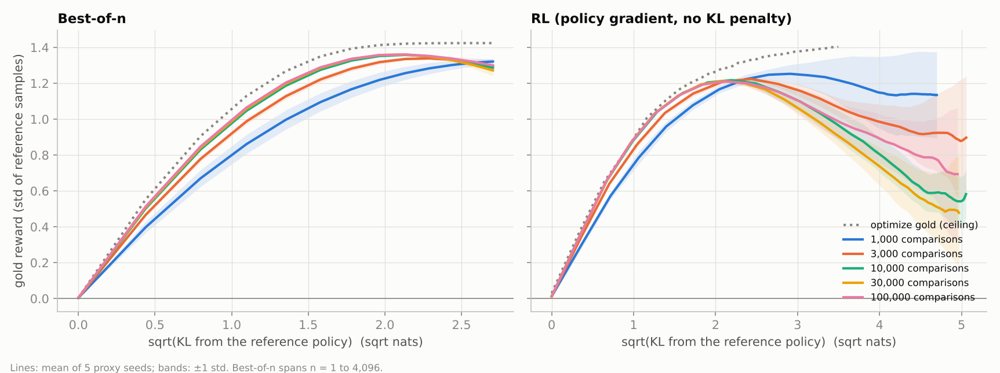
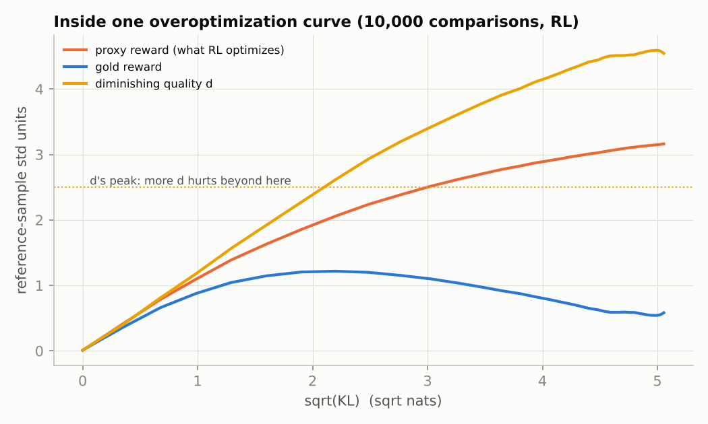
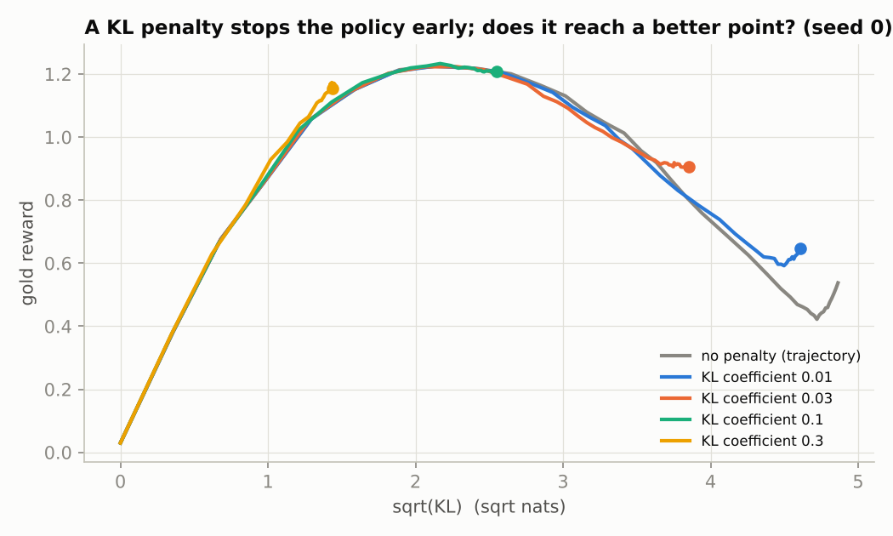
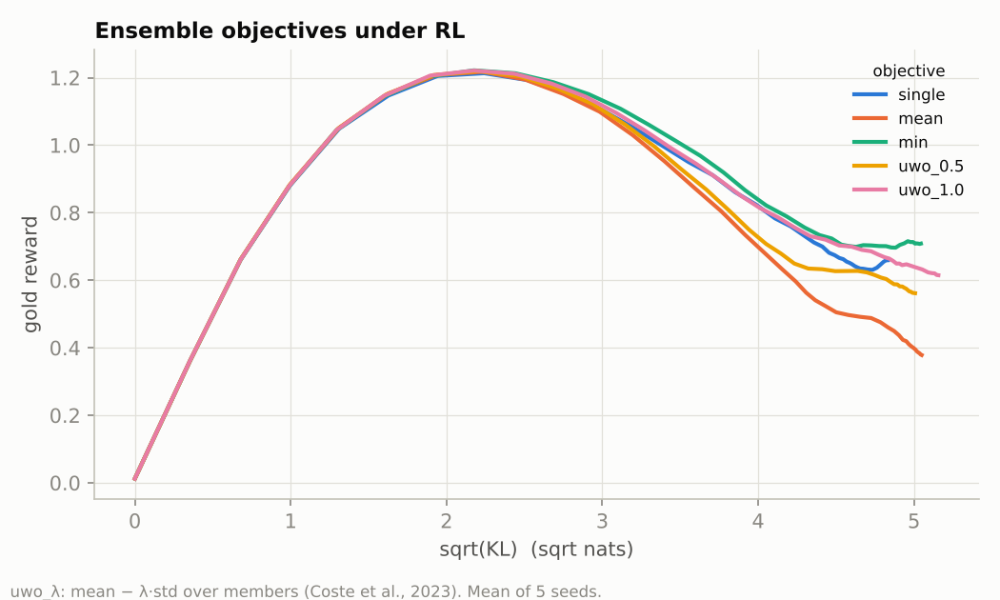
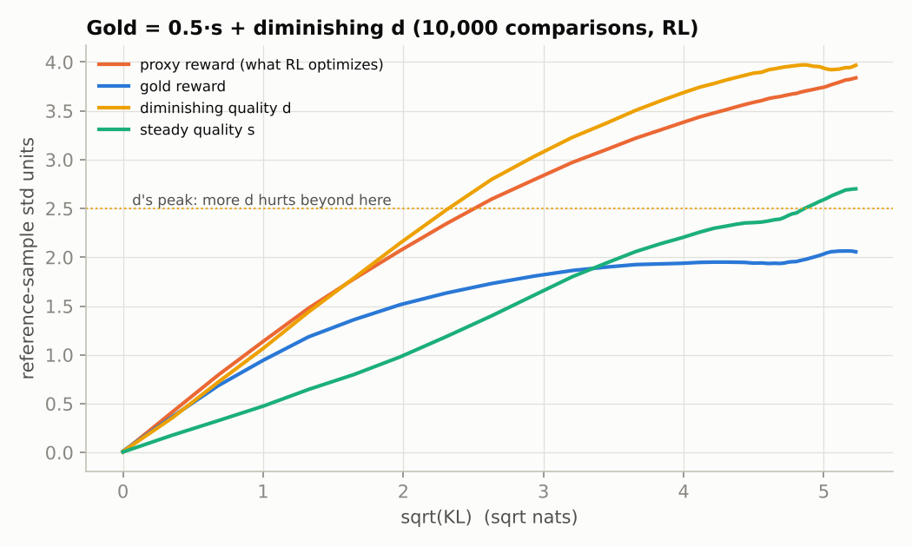

# Reward-model overoptimization: when optimizing a learned reward stops helping

RLHF optimizes a policy against a *learned* reward model, which is only a proxy for what people want. Push too hard and the policy finds what the proxy over-rates: proxy reward keeps rising while true quality falls (Goodhart's law). This project rebuilds the synthetic setup of [Gao, Schulman & Hilton (2022), *Scaling Laws for Reward Model Overoptimization*](https://arxiv.org/abs/2210.10760) at CPU scale and tests three things practitioners do about it:
- train the reward model on **more preference data**;
- add a **KL penalty**;
- use **reward-model ensembles** ([Coste et al., 2023](https://arxiv.org/abs/2310.02743)).

**Status: run end to end on a CPU (~15 min). All numbers below are measured, from [`results/`](results).**

## Setup ([`goodhart.py`](goodhart.py))
| Piece | What it is |
|---|---|
| Policy | autoregressive over 16 tokens from a vocabulary of 8. Each position has a next-token table conditioned on the previous token, so KL(policy ‖ reference) is computed **exactly**, not estimated |
| Reference policy | random Dirichlet(0.5) tables: a "pretrained" model with common and rare sequences |
| Gold reward (stands in for human judgement) | a quality `d` (a fixed random network, normalized on reference samples) with **diminishing, then negative, returns**: `gold = d − d² / (2 · 2.5)`. More `d` helps up to 2.5 reference standard deviations and hurts after that, the shape behind length hacking (readers like longer answers, up to a point). Only **0.7 %** of reference samples are past the turn |
| Proxy reward models | MLPs trained with the Bradley-Terry loss on 1k–100k comparisons between reference samples, labelled by the gold reward *with* Bradley-Terry noise; early-stopped on held-out pairs |
| Best-of-n | sample n from the reference, keep the proxy's favourite. KL = log n − (n−1)/n. Gold reward uses the exact unbiased estimator over a pool of 524k samples, not repeated draws |
| RL | policy gradient with a leave-one-out baseline (RLOO), 800 steps × 512 samples, optional exact KL penalty |

**Statistics, fixed before running:**
- 5 seeds of proxy training per setting (each seed draws new comparisons and a new initialization);
- mean ± std over seeds;
- KL-penalty and ensemble comparisons are **paired**: same proxies and seeds, reported with how many seeds favour each side.

## Results
### 1. Overoptimization appears, and RL overshoots much harder than best-of-n


| Comparisons | Agreement with gold | Best-of-n: peak gold (n at peak) | Best-of-n: gold at n = 4,096 | RL: peak gold | RL: KL at peak (nats) | RL: final gold | RL: final proxy |
|---|---|---|---|---|---|---|---|
| 1,000 | 75.8 % | 1.32 ± 0.02 (n = 4,096) | 1.32 ± 0.02 | 1.31 ± 0.08 | 11.6 ± 5.0 | 1.13 ± 0.24 | 4.47 ± 0.59 |
| 3,000 | 81.7 % | 1.34 ± 0.01 (n = 256–512) | 1.29 ± 0.01 | 1.25 ± 0.06 | 10.3 ± 8.8 | 0.90 ± 0.34 | 4.30 ± 0.19 |
| 10,000 | 85.9 % | 1.36 ± 0.00 (n = 256) | 1.29 ± 0.02 | 1.22 ± 0.01 | 4.6 ± 0.4 | 0.58 ± 0.13 | 3.16 ± 0.18 |
| 30,000 | 86.9 % | 1.36 ± 0.00 (n = 256) | 1.27 ± 0.03 | 1.21 ± 0.01 | 4.4 ± 0.1 | 0.48 ± 0.31 | 2.54 ± 0.20 |
| 100,000 | 87.7 % | 1.36 ± 0.00 (n = 256) | 1.30 ± 0.03 | 1.21 ± 0.01 | 4.5 ± 0.4 | 0.69 ± 0.37 | 2.59 ± 0.12 |

Optimizing the gold reward itself (the ceiling) reaches 1.40 with RL and 1.42 with best-of-4,096. Gold and proxy rewards are in units of the reference samples' standard deviation.

- **The proxy keeps climbing and the gold reward does not.** RL drives the proxy to 2.5–4.5 while gold peaks at ~1.2 near KL ≈ 4.5 nats and then falls by half or more.
- **The mechanism is visible.** The policy keeps increasing the diminishing quality straight through its turning point (dotted line below). The proxies never learned that turn, because almost none of their training samples were past it:

  
- **Best-of-n barely overoptimizes.** It can only pick among reference samples, so it stays within ~3 KL nats. Its decline after n = 256 is small: 1.36 → 1.29.
- **Gao et al.'s functional forms fit.** For best-of-n, gold = d(α − βd) with d = √KL fits with R² ≥ 0.998 at every data size. The RL form d(α − β log d) fits less well (R² 0.88–0.95): the real RL curves fall faster after the peak than the log form allows. Fitted coefficients are in [`results/summary.json`](results/summary.json).

### 2. More preference data did **not** delay overoptimization here; it made the overshoot worse
This contradicts the intuition that a better reward model is safer, and it is the most useful result of the study.
- **The RL peak arrives earlier with better proxies.** With 10k or more comparisons it comes at KL ≈ 4.5 (std 0.1–0.4 across seeds); with 1k it comes at 11.6 ± 5.0.
- **Better proxies finish worse.** Final gold falls from 1.13 (1k comparisons) to 0.48–0.69 (≥ 10k).
- **Why:**
  - more data teaches the proxy the *in-distribution* trend ("more d is better") more precisely, so RL follows it further and faster;
  - more samples from the same reference distribution add almost no information about the region past the peak, where the proxy is wrong.
  - A noisy 1k-comparison proxy is partly random, so RL wanders instead of marching up the trend.
- **The lesson:** reward-model errors that come from *extrapolation* are not fixed by more data from the same distribution. They need data from where the policy goes, as in iterated/online RLHF, or a limit on how far the policy moves.

### 3. A KL penalty mostly acts like early stopping


| KL coefficient | Final KL (nats) | Final gold | Unpenalized run on the same proxy, stopped at the same KL | Penalty − early stopping (seeds where penalty is better) |
|---|---|---|---|---|
| 0.01 | 24.0 ± 1.9 | 0.68 ± 0.14 | 0.58 ± 0.13 | +0.10 ± 0.07 (5/5) |
| 0.03 | 17.2 ± 1.7 | 0.86 ± 0.06 | 0.75 ± 0.08 | +0.12 ± 0.07 (5/5) |
| 0.1 | 7.1 ± 0.6 | **1.20 ± 0.02** | 1.17 ± 0.04 | +0.03 ± 0.03 (4/5) |
| 0.3 | 2.2 ± 0.1 | 1.16 ± 0.01 | 1.10 ± 0.01 | +0.06 ± 0.01 (5/5) |

- **Same path, earlier stop.** Penalized runs trace almost the same gold-vs-KL path as the unpenalized run and stop where the penalty balances the reward. That matches Gao et al.: a KL penalty is close to early stopping.
- **A small but consistent edge.** At the same KL, the penalized run ends 0.03–0.12 higher in 19 of 20 seed × coefficient pairs.
- **Its practical value is a stable stopping point.** With coefficient 0.1, every seed settles at 1.20 ± 0.02, close to the best gold any proxy reached. Early stopping gets there only if you know when to stop, which needs the gold reward you do not have.

### 4. Ensembles did not help, because the members share the same blind spot


| Objective (5 proxies, same 10k comparisons, different initializations) | RL: final gold | Final gold − single member (seeds better) | Best-of-4,096 − single member |
|---|---|---|---|
| single member | 0.66 ± 0.29 | — | — |
| mean | 0.38 ± 0.24 | −0.28 ± 0.16 (0/5) | −0.00 ± 0.04 (3/5) |
| worst case (min) | 0.71 ± 0.30 | +0.05 ± 0.30 (3/5) | +0.03 ± 0.04 (4/5) |
| mean − 0.5·std (UWO) | 0.56 ± 0.26 | −0.10 ± 0.19 (3/5) | +0.01 ± 0.04 (4/5) |
| mean − 1.0·std (UWO) | 0.61 ± 0.23 | −0.04 ± 0.26 (3/5) | +0.02 ± 0.04 (4/5) |

- **The mean ensemble is a better proxy, and it overshoots harder.** It is worse than one member in 5 of 5 seeds, for the same reason as result 2.
- **Conservative objectives don't help either.** Worst-case and uncertainty-weighted objectives are within noise of a single member: no seed-consistent gain.
- **Why:** ensemble uncertainty only flags errors where members *disagree*. Members trained on the same in-distribution data extrapolate the same trend past the peak, so their disagreement stays low exactly where the shared error is largest.
- **Contrast with Coste et al.,** who found that ensembles do help. That is consistent with their errors coming more from idiosyncratic member noise than from a shared extrapolation.

### 5. Control: when only part of the reward has diminishing returns, the decline disappears
Rerun of result 1 with `gold = 0.5 · s + d − d² / 5`, where `s` is a second quality with steady returns ([`results/summary_mixed.md`](results/summary_mixed.md)):

| Comparisons | RL: peak gold | RL: final gold | RL: final proxy | Best-of-4,096 gold |
|---|---|---|---|---|
| 1,000 | 1.54 ± 0.14 | 1.51 ± 0.14 | 4.10 ± 0.08 | 1.50 ± 0.04 |
| 10,000 | 2.17 ± 0.33 | 2.06 ± 0.50 | 3.84 ± 0.16 | 1.90 ± 0.04 |
| 100,000 | 2.42 ± 0.30 | **2.37 ± 0.36** | 3.25 ± 0.26 | 2.02 ± 0.06 |



- **Gold plateaus instead of falling.** The policy still overshoots `d`, but the gains in `s` offset the loss.
- **More data helps again.** Final gold rises from 1.51 to 2.37 as comparisons go from 1k to 100k, the "better reward model, better policy" result most people expect.
- **The proxy still over-rates the policy.** It reports 3.3–4.1 while gold is 1.5–2.4, so the gap between proxy and gold is not by itself evidence of a decline.
- **Taken together with result 2:** whether more preference data helps depends on whether the proxy's largest errors are extrapolation along a direction the optimizer pushes hardest.

## Limits
- **A toy reward.** The gold reward is a designed function of one learned feature with a diminishing-returns shape. It isolates one way proxies fail: extrapolating an in-distribution trend. It is not a model of every reward-hacking mode.
- **A small policy.** The policy class is small (16 tokens, Markov), so RL converges to near-deterministic outputs at KL ≈ 25 nats.
- **What to rerun at LLM scale:** whether result 2 holds when the proxy has many features that each extrapolate differently, and whether ensembles help there.

## Files
| File | Purpose |
|---|---|
| [`goodhart.py`](goodhart.py) | policy with exact KL, gold reward, preference data, Bradley-Terry training, ensembles, best-of-n estimator, RLOO, functional-form fits |
| [`train.py`](train.py) | the whole study → `results/study.json` |
| [`analyze.py`](analyze.py) | tables (`results/summary.md`) and figures |
| [`../../tests/test_reward_overoptimization.py`](../../tests/test_reward_overoptimization.py) | 11 tests: exact KL against brute force, best-of-n estimator against simulation, proxies learn a known reward, ensembles, RL, fits, end-to-end run |

```bash
python train.py                     # ~15 min on one CPU core
python train.py --w_steady 0.5 --no_extras --out results/study_mixed.json   # gold reward with a steady-returns part too
python analyze.py
```
