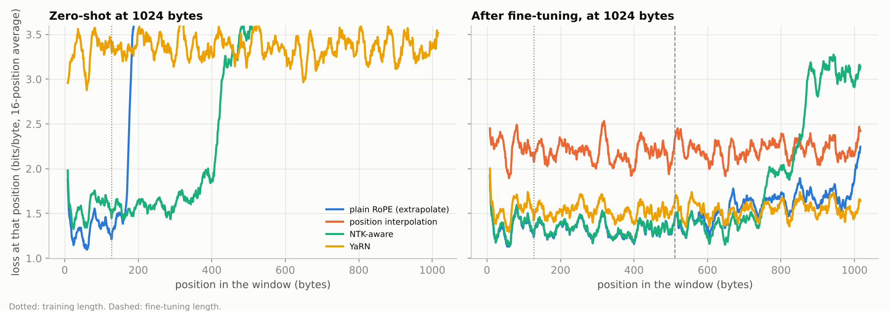

# Extending context length: RoPE extrapolation vs interpolation, NTK and YaRN

LLMs are pretrained on short windows and then stretched to long ones by rescaling their rotary position embeddings (RoPE). Code Llama, Qwen and Llama 3 all do this. This project implements the four standard options in the shared byte-level GPT ([`dl_common/bytelm.py`](../../src/dl_common/bytelm.py), `rope_frequencies`):

| Method | What it changes |
|---|---|
| none | nothing: positions beyond the training length are extrapolated |
| PI ([Chen et al., 2023](https://arxiv.org/abs/2306.15595)) | divides every rotary frequency by the scale factor, squeezing long contexts into the trained position range |
| NTK-aware ([bloc97, 2023](https://www.reddit.com/r/LocalLLaMA/comments/14lz7j5/)) | raises the RoPE base, leaving the fastest frequencies (local order) almost unchanged and stretching the slowest |
| YaRN ([Peng et al., 2023](https://arxiv.org/abs/2309.00071)) | per-frequency blend: keep frequencies that turn many times inside the training window, interpolate those that turn less than once, ramp in between; plus an attention temperature (0.1 ln s + 1)² |

The study trains a model at 128 bytes and measures each method at up to 1,024 bytes (8×), both without training and after a short long-context fine-tune.

**Status: run end to end on a CPU (~25 min). All numbers below are measured, from [`results/`](results).**

## Setup ([`train.py`](train.py))
- **Model and pretraining:** a 4-layer byte-level GPT with RoPE (d_model 128, 4 heads of 32 dims, base 10,000), trained on 128-byte windows of the Python standard library's source for 2,000 steps (8.2M bytes).
- **Zero-shot evaluation:** each method on windows of 128–1,024 bytes, with scale factor = length / 128.
- **Fine-tuning:**
  - 200 steps on 512-byte windows (0.8M bytes, 10 % of pretraining) with each method active at factor 4;
  - **control:** 200 more steps at 128 bytes, to separate long-context data from simply more training;
  - evaluation at 512 and 1,024 bytes, with the factor growing with length ("dynamic") or kept at 4 ("fixed").
- **Statistics:** every number uses the same 64 held-out windows; differences are paired bootstrap 95 % intervals over windows.

## Results
### Zero-shot: nothing works far beyond the training length, and the methods fail differently
| Method | 128 bytes | 256 | 512 | 1,024 |
|---|---|---|---|---|
| plain RoPE | **1.381** | 2.275 | 3.687 | 4.598 |
| position interpolation | 1.381 | 3.253 | 4.335 | 4.943 |
| NTK-aware | 1.381 | **1.569** | **2.481** | 3.448 |
| YaRN | 1.381 | 2.101 | 2.876 | **3.348** |



Loss by position (left panel) shows each method's failure mode:
- **Plain RoPE** is excellent up to byte 128 and collapses right after it: the rotation angles past 128 were never seen in training.
- **NTK** works to about 3× the training length, then breaks.
- **PI** is bad *everywhere*, even at position 10 (4.75 bits/byte over the first 128 positions at 8×). Dividing every frequency by 8 also slows the fast frequencies that encode the order of neighbouring bytes, and a byte-level model depends on exactly that.
- **YaRN** is flat but mediocre (~3.3 at every position). It protects the fast frequencies, but its middle frequencies and attention temperature are still off-distribution without training.

### After a short fine-tune at 512 bytes, plain RoPE and NTK are best inside the window, YaRN beyond it
| Fine-tuned with | 512 bytes | 1,024 bytes (dynamic factor) | 1,024 bytes (factor fixed at 4) |
|---|---|---|---|
| plain RoPE | 1.341 | **1.475** | 1.475 |
| NTK-aware | **1.331** | 1.701 | 1.881 |
| YaRN | 1.349 | 1.543 | 2.745 |
| position interpolation | 1.436 | 2.209 | 2.764 |
| control: 200 more steps at 128 bytes (best method at each length) | 2.461 (NTK) | 3.354 (YaRN) | — |

- **Long-context data, not more training, is what helps.** With 10 % extra data at 512 bytes, plain RoPE, NTK and YaRN all beat the model's own 128-byte loss (1.381): they now *use* the longer context.
  - The control, 200 more steps at 128 bytes, leaves every method as broken as before.
- **Within the fine-tuning length the methods nearly tie, except PI.** Against plain RoPE at 512 bytes:

| Method | Difference vs plain RoPE (bits/byte) | 95 % interval |
|---|---|---|
| NTK | −0.010 | (−0.014, −0.006) |
| YaRN | +0.009 | (+0.002, +0.016) |
| PI | **+0.095** | (+0.080, +0.111) |

- **Beyond the fine-tuning length, the methods differ.** Average loss over bytes 512–1,024 of the 1,024-byte windows:

| Method | Bits/byte, bytes 512–1,024 |
|---|---|
| YaRN | **1.54** |
| plain RoPE | 1.61 |
| NTK | 2.05 |
| PI | 2.22 |

  - YaRN stays flat out to 1,024.
  - YaRN pays for that inside the window: at factor 8 its rescaling also applies to the early positions (1.59 vs 1.40 for plain RoPE over the first 128 bytes).
  - Over the whole 1,024-byte window, plain RoPE fine-tuned at 512 is best (1.475).
- **Scale with the sequence length, not with the fine-tuning length.** Keeping the factor at its fine-tuning value is worse at 1,024 bytes for every method: YaRN goes from 1.54 to 2.75.

### What this says about byte-level vs token-level models
- **Why PI failed here.** PI's poor showing is likely specific to fine-grained tokens: a byte-level model needs exact local order, which PI blurs.
- **Why it works in LLMs.** With subword tokens, neighbouring positions carry less fine-grained information, and PI is used successfully there.
- **What carries over.** Two findings are likely general:
  - methods that protect the high frequencies (NTK, YaRN) are the safe default;
  - a short fine-tune on long data matters far more than the choice of method.

## Limits
- **One small model, one seed.** The model was pretrained once (~11 min on a CPU).
- **What the intervals cover.** They capture evaluation-window variance, not training variance.

## Tests (`pytest tests/test_long_context_rope.py`)
- **Scaling-method properties:**
  - PI = base / s;
  - NTK keeps the fastest frequency and divides the slowest by s;
  - YaRN keeps fast frequencies, interpolates slow ones and has the documented temperature;
  - at s = 1 every method is unchanged.
- **RoPE invariances:** the rotation preserves norms, and query-key scores depend only on the offset between positions.
- **RoPE model:** it is causal, and its scaling can be switched at evaluation time.
- **End to end:** a smoke run.

```bash
python train.py      # pretraining is cached in checkpoints/ (git-ignored)
python analyze.py
```
