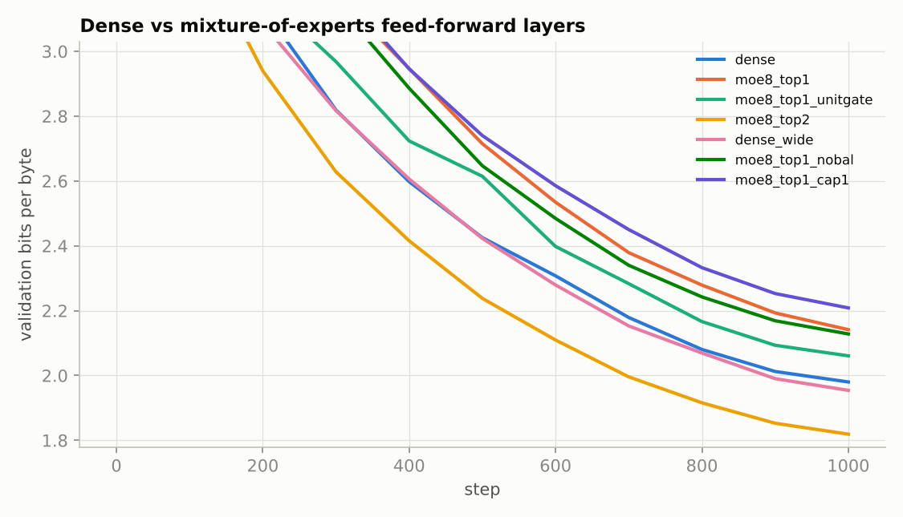
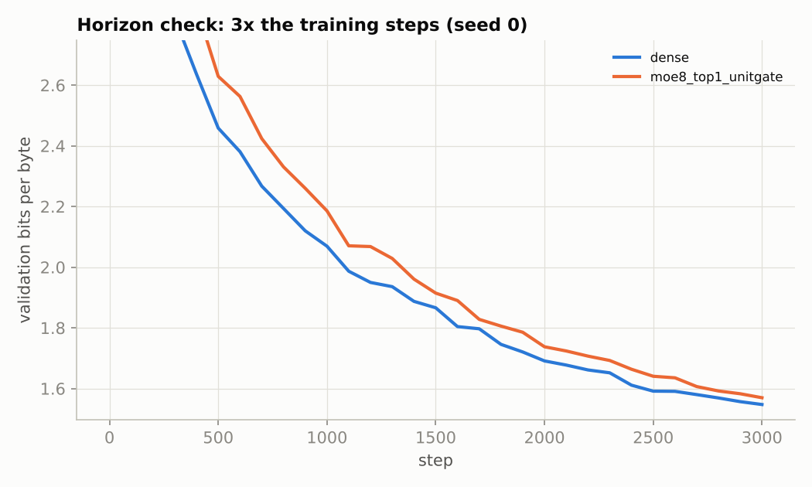
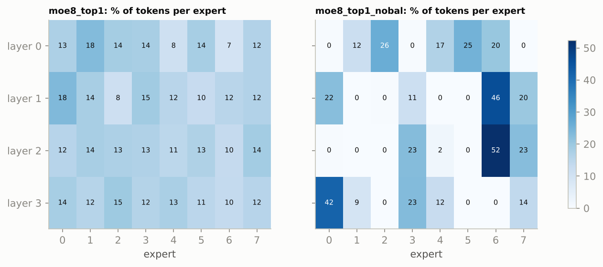
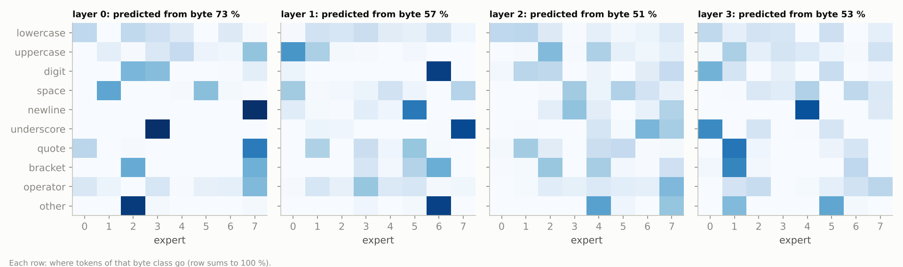

# Mixture of experts from scratch: routing, load balancing, and what the experts learn

Frontier models (Mixtral, DeepSeek-V3, and reportedly most large proprietary models) replace each transformer MLP with many "expert" MLPs and a router that sends each token to a few of them. Parameters grow with the number of experts while compute per token stays fixed. This project builds that layer from scratch ([`moe_layer.py`](moe_layer.py)) and measures, at small scale, the questions that decide whether it works:
1. Does sparse routing buy quality at matched compute?
2. What does the load-balancing loss prevent?
3. What does token dropping under a capacity limit cost?
4. What do experts specialize in?

**Status: run end to end on a CPU. All numbers below are measured, from [`results/`](results).**

## The layer
| Piece | Implementation |
|---|---|
| Router | linear d_model → E logits, softmax, top-k experts per token |
| Gates | top-1: the chosen expert's probability (Switch Transformer); top-2: the two probabilities renormalized to sum to 1 (Mixtral) |
| Load-balancing loss | Switch: E · Σₑ fₑ · Pₑ (fraction of tokens routed to e × mean router probability for e); equals 1 when balanced; coefficient 0.01 |
| Router z-loss | ST-MoE: mean(logsumexp(logits)²) × 10⁻³, keeps router logits small |
| Capacity | optional: each expert takes at most ⌈factor · k · tokens / E⌉ tokens per batch, and the rest skip the layer (first choices get priority) |
| Experts | 8 GELU MLPs, each the shape of the dense model's MLP (d_ff 512) |

All models are the same 4-layer byte-level GPT (d_model 128, context 64; [`dl_common/bytelm.py`](../../src/dl_common/bytelm.py)) trained on the Python standard library's source for 1,000 steps × 2,048 bytes with AdamW (lr 3e-3), 2 seeds each. Only the feed-forward layers differ.

## Results


| Config | MLP params per layer (active / stored) | Val bits/byte, 2 seeds | Δ vs dense, paired by seed | ms / step (interleaved benchmark, CPU) |
|---|---|---|---|---|
| dense (d_ff 512) | 131k / 131k | 1.996 ± 0.006 | — | 73 |
| top-1 of 8, Switch gate | 132k / 1,050k | 2.168 ± 0.069 | +0.17 ± 0.06 | 119 |
| top-1 of 8, unit gate (ablation) | 132k / 1,050k | 2.071 ± 0.024 | +0.07 ± 0.03 | 125 |
| top-1 of 8, no load-balancing loss | 132k / 1,050k | 2.139 ± 0.130 | +0.14 ± 0.12 | 106 |
| top-1 of 8, capacity factor 1.0 | 132k / 1,050k | 2.233 ± 0.044 | +0.24 ± 0.04 | 99 |
| dense wide (d_ff 1024) | 262k / 262k | 1.968 ± 0.006 | −0.03 ± 0.01 | 137 |
| **top-2 of 8 (Mixtral style)** | 263k / 1,050k | **1.841 ± 0.017** | **−0.16 ± 0.01** | 172 |

### 1. Top-2 MoE beats dense at matched compute; top-1 does not, at this scale
- **Top-2 wins.** It beats the dense model with the same active parameters (dense wide) by **0.13 bits/byte**, on both seeds, with 4× the stored MLP parameters.
- **Top-1 loses.** Switch-style top-1 is *worse* than dense at matched compute. Two causes, each measured:
  - **Gate scale.** Switch multiplies an expert's output by its router probability, which starts near 1/8. Every MLP branch therefore starts 8× weaker than the dense model's. A unit gate (forward value 1, router gradient kept; `unit_gate=True`) cuts the deficit from 0.17 to 0.07 bits/byte.
  - **Too little data per expert.** With top-1 each expert trains on 1/8 of the tokens, and here that is only ~250k bytes each. The longer run below shows the gap closing with data; top-2 doubles each expert's share and wins.



- **Horizon check (seed 0, 3× the steps):**
  - dense reaches 1.567 and unit-gate top-1 1.608, so for this seed the deficit falls from 0.054 at 1,000 steps to 0.040;
  - it has not crossed over within 6M bytes. At this scale top-1 MoE is a bet on more data than was trained on here.
- **Wall-clock cost of routing on a CPU.** Top-2 is 1.25× slower per step than dense wide despite matching FLOPs. The router, the gather and scatter, and the per-expert small matrix multiplies are pure overhead; production MoE kernels exist to remove them (grouped GEMM, expert parallelism).

### 2. Without the load-balancing loss the router collapses


| | Load entropy (max 3 bits) | Largest expert's share | Experts with < 1 % of tokens (per layer) |
|---|---|---|---|
| with balancing loss (top-1) | 2.98 | 15 % | 0 |
| **without** | **1.86** | **45 %** (up to 54 %) | **3.4** (2–5 of 8) |

- **Collapse.** Without the loss, 2 to 5 of the 8 experts in each layer receive almost no tokens, and one expert takes up to half of them.
- **No consistent quality cost at this scale:** 2.23 and 2.05 vs 2.22 and 2.12 for the balanced model, varying with the seed.
- **The cost is wasted capacity and, at scale, throughput.** Dead experts are parameters doing nothing. Under expert parallelism, the device holding a 50 % expert becomes the straggler for every step. The loss buys a near-uniform load (15 % max vs 12.5 % ideal) at no measurable quality cost.

### 3. Capacity limits drop tokens, and dropped tokens cost quality
With capacity factor 1.0, 5.6 % of tokens overflow their expert and skip the layer. That is worse on both seeds (+0.065 bits/byte vs unlimited top-1). Production systems use factors of 1.25–2 or dropless kernels for this reason.

### 4. What the experts specialize in: mostly *which byte*, mostly in the first layer


How often a lookup table from the current byte predicts the router's choice on held-out text (majority-class baseline: 15 %):

| Model | Layer 0 | Layer 1 | Layer 2 | Layer 3 |
|---|---|---|---|---|
| top-1, seed 0 | 73 % | 57 % | 51 % | 53 % |
| top-2, seed 0 | 84 % | 49 % | 49 % | 52 % |

- **Layer 0 routes almost entirely by token identity.** Newlines go to one expert, underscores to another, rare symbols and non-ASCII bytes to a third, and digits are split across two.
- **Deeper layers route on context.** The current byte explains only about half of the choices there. This matches what has been reported for large MoE language models: routers in early layers learn token-level clustering, not topics.

### Limits
- **Small scale.** Two seeds, a 4-layer model and 2–6M bytes of training data. MoE's advantages are known to grow with model and data size.
- **Not production kernels.** CPU timings with a Python loop over experts.


## Tests (`pytest tests/test_mixture_of_experts.py`)
- **Identical experts:** with every expert the same MLP, the layer equals that MLP, which checks routing, gating and the scatter-back.
- **Top-1 routing:** each token's output is its top expert's output times the gate.
- **Load-balancing loss:** exactly 1 for uniform routing; → E when every token goes to one expert.
- **Capacity:** with capacity factor 1, overflow tokens are dropped and pass through unchanged.
- **Unit gate:** forward value 1 while the router still gets gradient.
- **End to end:** a smoke run of training, benchmark and analysis.

```bash
python train.py            # all configurations x 2 seeds, then the horizon check
python train.py --bench    # interleaved step-time benchmark -> results/step_time.json
python analyze.py
```
