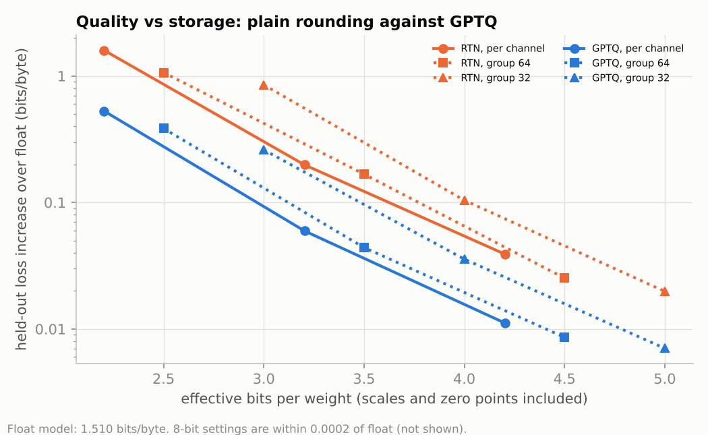

# Post-training quantization from scratch: round-to-nearest vs GPTQ

Serving large models cheaply means storing weights in 4 bits or fewer. Two methods are compared here:
- **Round-to-nearest (RTN)** rounds every weight independently.
- **[GPTQ](https://arxiv.org/abs/2210.17323)** quantizes a layer one input column at a time. After each column it updates the remaining columns to cancel the error that column caused on real inputs, using the inverse Hessian H⁻¹ of the layer's reconstruction loss (H = 2XXᵀ/n over calibration activations).

Both are written from the papers in [`weight_quant.py`](weight_quant.py) and applied to a byte-level language model trained here. The study measures quality against storage at 8, 4, 3 and 2 bits.

**Status: run end to end on a CPU. All numbers below are measured, from [`results/`](results).**

## Setup
| | |
|---|---|
| Model | 4-layer byte-level GPT, d_model 128, context 128 ([`dl_common/bytelm.py`](../../src/dl_common/bytelm.py)), trained for 2,000 steps (8.2M bytes) on the Python standard library's source |
| Quantized | every linear layer inside the transformer blocks: attention QKV and output, MLP in and out (786k weights). Embeddings, output head and LayerNorm stay in float, as is usual |
| Format | asymmetric b-bit integers with a scale and zero point per output row ("per channel") or per group of 64 / 32 input columns; storage counts 16-bit scales and zero points |
| GPTQ | blocks of 128 columns, 1 % dampening; layers quantized block by block, so each block's calibration activations come from the already-quantized earlier blocks (as in the paper); 128 calibration windows of 128 bytes from the training files |
| Metric | bits per byte on 1,024 held-out windows (131k bytes); GPTQ repeated with 3 calibration sets, mean ± std |

## Results
Float model: **1.510 bits per byte** on held-out files.



| Bits | Groups | Effective bits / weight | RTN (Δ vs float) | GPTQ (Δ vs float), 3 calibration sets | Share of RTN's damage GPTQ removes |
|---|---|---|---|---|---|
| 8 | per channel | 8.2 | 1.5101 (+0.0001) | 1.5100 ± 0.0001 (−0.0000) | — |
| 4 | per channel | 4.2 | 1.5490 (+0.039) | **1.5212 ± 0.0013 (+0.011)** | 71 % |
| 4 | 32 | 5.0 | 1.5299 (+0.020) | 1.5171 ± 0.0009 (+0.007) | 65 % |
| 3 | per channel | 3.2 | 1.7083 (+0.198) | 1.5696 ± 0.0018 (+0.060) | 70 % |
| 3 | 64 | 3.5 | 1.6775 (+0.168) | 1.5540 ± 0.0025 (+0.044) | 74 % |
| 3 | 32 | 4.0 | 1.6141 (+0.104) | 1.5457 ± 0.0050 (+0.036) | 66 % |
| 2 | per channel | 2.2 | 3.1067 (+1.597) | 2.0389 ± 0.0079 (+0.529) | 67 % |
| 2 | 32 | 3.0 | 2.3613 (+0.851) | 1.7706 ± 0.0037 (+0.261) | 69 % |

All 12 settings are in [`results/summary.md`](results/summary.md).

- **8 bits is free; 4 bits is nearly free with GPTQ.** With GPTQ, 4-bit per-channel weights (4.2 bits each, 7.6× smaller than float32) cost 0.011 bits/byte (+0.7 %). RTN at the same size costs 3.5× more.
- **GPTQ removes 64–74 % of RTN's damage at every bit width and group size.** That consistency suggests a property of the method rather than of one setting.
- **GPTQ lets you drop a bit.** 3-bit GPTQ in groups of 32 (4.0 bits per weight) beats 4-bit RTN per channel (4.2 bits): +0.036 vs +0.039.
- **GPTQ's weights are *further* from the originals.** Its relative weight error is 41–49 % higher than RTN's in every setting (e.g. 0.34 vs 0.24 at 3 bits per channel), yet its loss is far lower. GPTQ minimizes the error of the layer's *outputs* on real inputs, which is what matters; weight-space error is the wrong thing to look at.
- **Spend bits on precision before metadata.** With a 16-bit scale and zero point per group, groups of 32 cost a whole extra bit per weight. On the storage frontier in the figure, per-channel quantization at the next bit width is as good as or better than finer groups.

### Which layers are fragile (RTN, 3 bits, one layer type at a time)
| Layer type | Δ bits/byte |
|---|---|
| attention QKV | +0.063 |
| MLP in | +0.050 |
| MLP out | +0.041 |
| attention output | +0.011 |

QKV is the most sensitive: errors there change *which* positions attention reads, not just how much. The attention output projection, a quarter of the attention weights, is nearly free to quantize. Mixed precision would spend its extra bits on QKV.

### How much calibration data GPTQ needs (3 bits, group 64)
| Calibration windows (× 128 bytes) | Δ bits/byte |
|---|---|
| 4 | +0.068 ± 0.007 |
| 16 | +0.047 ± 0.004 |
| 64 | +0.041 ± 0.001 |
| 256 | +0.044 ± 0.002 |

Gains saturate by ~64 windows (8k bytes). Below that, the Hessian estimate is noisy and quality varies by calibration set.

### Limits
- **Small model, briefly trained.** Large LLMs develop a few huge activation outliers that make quantization harder (the reason for SmoothQuant and AWQ). This model was not checked for them, so absolute damage at scale will differ; the method-level comparisons are the point.
- **Weights only.** Activations stay in float, and no integer kernels were written, so this measures quality and storage, not speed.


## Tests (`pytest tests/test_quantization.py`)
- **RTN:** stays on the grid with error at most half a step; finer groups reduce the error.
- **GPTQ equals RTN when inputs are uncorrelated (H ∝ I).** There is nothing to compensate, and this pins down the error-propagation code.
- **GPTQ beats RTN on correlated inputs.** Its output error is below 0.7× RTN's.
- **Storage accounting:** the effective-bits formula.
- **End to end:** a smoke run of training, quantization and analysis.

```bash
python train.py      # trains the model once (cached in checkpoints/), then every quantization setting
python analyze.py
```
